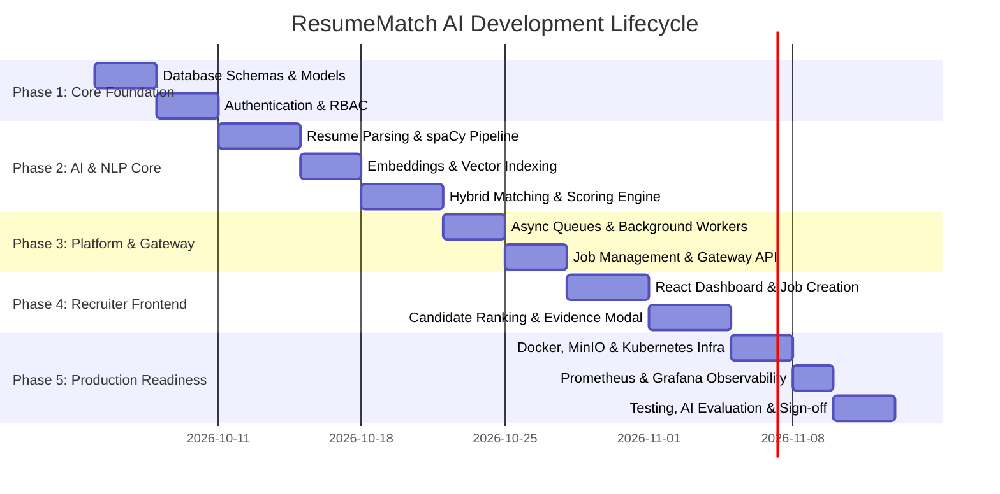
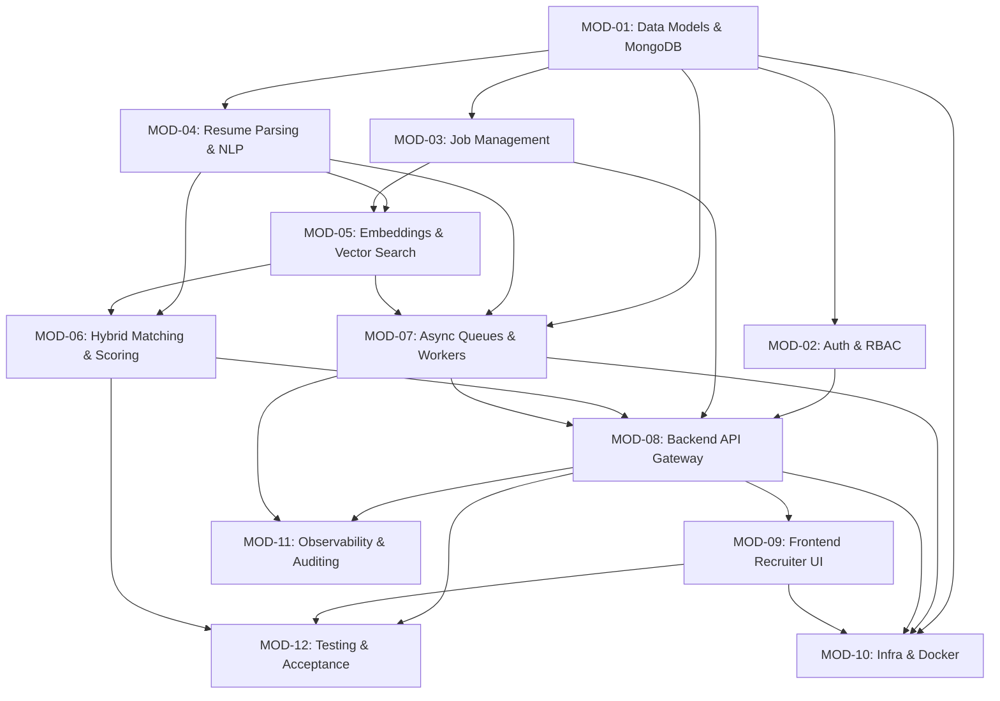

# ResumeMatch AI — Master Implementation Plan

> **Document Version:** 1.0.0  
> **Source Baseline:** [ResumeMatch AI SRS v1.0](file:///c:/Users/WELCOME/OneDrive/Desktop/Project%202%20ResumeMatch%20AI/docs/ResumeMatch_AI_SRS.pdf) & [PROJECT_CONTEXT.md](file:///c:/Users/WELCOME/OneDrive/Desktop/Project%202%20ResumeMatch%20AI/PROJECT_CONTEXT.md)  
> **Execution Strategy:** Phased, Modular, Test-Driven Implementation  

---

## 1. Executive Implementation Roadmap

This master implementation plan establishes the sequential execution phases, dependency graphs, and dedicated module specifications for engineering **ResumeMatch AI**. 

To maintain clean modular boundaries and production maintainability, each functional module has a **dedicated, in-depth implementation specification** in the `docs/modules/` directory.

### 1.1 Implementation Phases & Milestones

---

## 2. Master Module Index & Traceability

Every module below contains a dedicated, comprehensive implementation blueprint located in `docs/modules/`:

| Module ID | Module Title | Dedicated Spec File | Primary Responsibilities | SRS Traced Requirements |
| :---: | :--- | :--- | :--- | :--- |
| **MOD-01** | **Database & Data Models** | [01_database_and_models_plan.md](file:///c:/Users/WELCOME/OneDrive/Desktop/Project%202%20ResumeMatch%20AI/docs/modules/01_database_and_models_plan.md) | MongoDB Mongoose schemas, validation, indexes, data retention | SRS §6 (Data Req), §6.1, §6.2, §6.3 |
| **MOD-02** | **Authentication & RBAC** | [02_auth_and_rbac_plan.md](file:///c:/Users/WELCOME/OneDrive/Desktop/Project%202%20ResumeMatch%20AI/docs/modules/02_auth_and_rbac_plan.md) | JWT auth, recruiter/admin roles, password hashing, session guards | FR-AUTH-01 to 04, SRS §10.1 |
| **MOD-03** | **Job Management Engine** | [03_job_management_plan.md](file:///c:/Users/WELCOME/OneDrive/Desktop/Project%202%20ResumeMatch%20AI/docs/modules/03_job_management_plan.md) | Job CRUD, free-text JD parsing, required vs preferred skills | FR-JOB-01 to 05, AC-01 |
| **MOD-04** | **Resume Parsing & NLP** | [04_resume_parsing_and_nlp_plan.md](file:///c:/Users/WELCOME/OneDrive/Desktop/Project%202%20ResumeMatch%20AI/docs/modules/04_resume_parsing_and_nlp_plan.md) | PDF/DOCX ingestion, spaCy linguistic pipeline, canonical alias dictionary | FR-CAN-01 to 06, EC-01 to 07 |
| **MOD-05** | **Embeddings & Vector Search** | [05_embeddings_and_vector_search_plan.md](file:///c:/Users/WELCOME/OneDrive/Desktop/Project%202%20ResumeMatch%20AI/docs/modules/05_embeddings_and_vector_search_plan.md) | Sentence Transformers (`all-MiniLM-L6-v2`), ChromaDB/Qdrant vector index | FR-MATCH-02, SRS §5.2, EC-14 |
| **MOD-06** | **Hybrid Matching & Scoring** | [06_hybrid_matching_and_scoring_plan.md](file:///c:/Users/WELCOME/OneDrive/Desktop/Project%202%20ResumeMatch%20AI/docs/modules/06_hybrid_matching_and_scoring_plan.md) | Weighted multi-signal formula, grounded explainability, evidence snippets | FR-MATCH-01 to 07, FR-EVID-01 to 03, SRS §5.3, §5.4 |
| **MOD-07** | **Async Queues & Workers** | [07_async_queue_and_workers_plan.md](file:///c:/Users/WELCOME/OneDrive/Desktop/Project%202%20ResumeMatch%20AI/docs/modules/07_async_queue_and_workers_plan.md) | Redis BullMQ, non-blocking resume processing, batch fault tolerance | SRS §2.4, §3.1, AC-08, EC-10 |
| **MOD-08** | **Backend API Gateway** | [08_backend_api_gateway_plan.md](file:///c:/Users/WELCOME/OneDrive/Desktop/Project%202%20ResumeMatch%20AI/docs/modules/08_backend_api_gateway_plan.md) | Express REST controllers, middleware, S3 presigned URLs, input validation | SRS §7, FR-CAN-02, EC-02, EC-03 |
| **MOD-09** | **Frontend Recruiter UI** | [09_frontend_recruiter_ui_plan.md](file:///c:/Users/WELCOME/OneDrive/Desktop/Project%202%20ResumeMatch%20AI/docs/modules/09_frontend_recruiter_ui_plan.md) | React + Vite UI, Dashboard, Requirement Editor, Ranking Screen, Evidence Modal | SRS §8, FR-EVID-04 to 06 |
| **MOD-10** | **Infra, Docker & DevOps** | [10_infrastructure_and_docker_plan.md](file:///c:/Users/WELCOME/OneDrive/Desktop/Project%202%20ResumeMatch%20AI/docs/modules/10_infrastructure_and_docker_plan.md) | Multi-stage Dockerfiles, Docker Compose, AWS S3/MinIO, Kubernetes manifests | SRS §13, §3.1, §9 |
| **MOD-11** | **Observability & Auditing** | [11_observability_and_audit_plan.md](file:///c:/Users/WELCOME/OneDrive/Desktop/Project%202%20ResumeMatch%20AI/docs/modules/11_observability_and_audit_plan.md) | Prometheus metrics, Grafana dashboards, health checks, audit persistence | SRS §12, FR-AUTH-04, AC-10 |
| **MOD-12** | **Testing & AI Evaluation** | [12_testing_and_acceptance_plan.md](file:///c:/Users/WELCOME/OneDrive/Desktop/Project%202%20ResumeMatch%20AI/docs/modules/12_testing_and_acceptance_plan.md) | Unit, integration, E2E recruiter tests, AI groundedness benchmark, AC-01 to 10 | SRS §14, AC-01 to AC-10 |

---

## 3. Architecture & Dependency Flow

---

## 4. Phase-by-Phase Execution Guidelines

### Phase 1: Foundation & Data Architecture (MOD-01, MOD-02)
- Initialize MongoDB connections with Mongoose.
- Establish strict schema validation for Users, Jobs, Candidates, Resumes, Matches, and AuditLogs.
- Build secure authentication (Argon2 / bcrypt password hashing, stateless JWT with refresh tokens).
- Implement role-based access control (`recruiter`, `admin`).

### Phase 2: AI Microservice & NLP Core (MOD-04, MOD-05, MOD-06)
- Build FastAPI microservice with spaCy `en_core_web_md` and rule-based phrase matchers.
- Ingest and normalize `.pdf` and `.docx` documents; handle edge cases (empty, corrupted, scanned).
- Implement skill alias canonicalization (e.g. `K8s` -> `Kubernetes`).
- Load `all-MiniLM-L6-v2` Sentence Transformer model and initialize ChromaDB/Qdrant vector collection.
- Implement composite hybrid scoring formula ($35\%$ Semantic, $40\%$ Skills, $15\%$ Experience, $10\%$ Education).
- Produce grounded explainability payloads linking matched criteria to raw document evidence.

### Phase 3: Gateway, Job Management & Queuing (MOD-03, MOD-07, MOD-08)
- Build Job management APIs with status lifecycle (`draft`, `active`, `paused`, `closed`).
- Set up Redis BullMQ queues for non-blocking resume processing and embedding generation.
- Implement secure file upload handler (Multer) with magic-number validation and S3/MinIO upload.
- Protect endpoints with rate limiting and audit logging interceptors.

### Phase 4: Frontend Recruiter Workspace (MOD-09)
- Build modern React 18+ SPA with Vite and Tailwind CSS.
- Create Recruiter Dashboard showing active jobs, candidate stats, and recent matching activity.
- Build Job Creation Wizard with interactive requirement tag editor (required vs preferred).
- Build Candidate Ranking Screen with score meters, multi-facet filters, and sort options.
- Build Candidate Detail & Evidence Inspector with resume viewer and grounded proof highlights.

### Phase 5: Infrastructure, Observability & Acceptance (MOD-10, MOD-11, MOD-12)
- Assemble `docker-compose.yml` for unified local development (Frontend, Gateway, AI Service, Mongo, Redis, Chroma, MinIO).
- Configure Prometheus metrics endpoints and import Grafana operational dashboards.
- Execute automated unit, integration, and E2E test suites verifying AC-01 through AC-10.

---

## 6. Definition of Done (DoD)

A module is considered **Complete** only when:
1. All functional requirements traced to the module are implemented in code.
2. Edge cases defined in the module plan have corresponding automated test assertions.
3. Code adheres to TypeScript strict mode (for frontend/backend) or Pydantic strict typing (for Python AI service).
4. No sensitive secrets or credentials exist in source files.
5. Unit and integration tests pass with $\ge 85\%$ line coverage.
6. Documentation and API endpoint contracts are up to date.
