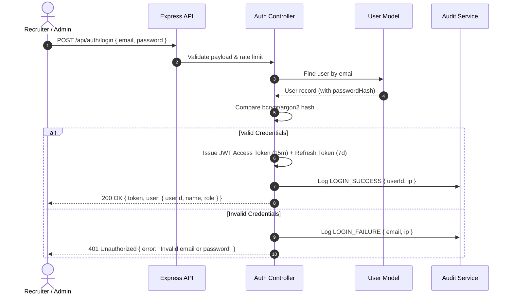

# Module 02: Authentication & Recruiter Access Control (RBAC) Implementation Plan

> **Module ID:** `MOD-02`  
> **Component:** Identity, Security & Role-Based Authorization  
> **Status:** Pending Implementation  
> **Traced Requirements:** FR-AUTH-01 (Sign in), FR-AUTH-02 (RBAC), FR-AUTH-03 (Unauthorized Rejection), FR-AUTH-04 (Audit Info), SRS §10.1  

---

## 1. Module Overview & Purpose

Module 02 establishes secure, stateless authentication and fine-grained authorization for ResumeMatch AI. It ensures that recruiters and administrators have authenticated access with least-privilege permissions, prevents unauthorized inspection of sensitive candidate records, and generates audit logs for all security-sensitive actions.

---

## 2. Technical Architecture & Security Flow



---

## 3. Detailed Component & Code Specifications

### 3.1 Token Strategy
- **Access Token:** Short-lived JWT (15-minute expiration) containing `{ userId, email, role, orgId }`.
- **Refresh Token:** Stored in HTTP-only, secure, `SameSite=Strict` cookie or Redis whitelist (7-day expiration).
- **Password Hashing:** `bcryptjs` with salt rounds = 12 or `argon2id`.

### 3.2 Key Files Layout
```
backend/src/
├── controllers/
│   └── auth.controller.ts    # login, register, refreshToken, me, logout
├── middleware/
│   ├── auth.ts               # verifyAccessToken JWT guard
│   ├── rbac.ts               # requireRole(['admin', 'recruiter'])
│   └── rateLimiter.ts        # brute force protection on /login (express-rate-limit)
└── services/
    └── token.service.ts      # sign/verify JWT, handle refresh tokens
```

---

## 4. Step-by-Step Implementation Tasks

- [ ] **Task 2.1:** Implement password hashing hooks in `User` model using `bcryptjs` / `argon2`.
- [ ] **Task 2.2:** Build `token.service.ts` for JWT generation, verification, and rotation.
- [ ] **Task 2.3:** Implement `auth.controller.ts` with `/login`, `/me`, `/refresh-token`, and `/logout` handlers.
- [ ] **Task 2.4:** Build `auth.ts` middleware to extract Bearer tokens from the `Authorization` header, verify validity, and attach `req.user`.
- [ ] **Task 2.5:** Build `rbac.ts` middleware allowing route guards like `requireRole('admin')` or `requireRole(['recruiter', 'admin'])`.
- [ ] **Task 2.6:** Implement rate limiting middleware (max 5 failed attempts per 15 minutes per IP) to prevent brute-force attacks.
- [ ] **Task 2.7:** Integrate automatic security audit trail logging for all login, logout, and token refresh events.

---

## 5. Security & Edge-Case Handling

- **Token Expiry During Review:** The frontend handles automatic silent token refresh via Axios response interceptors before user session expires.
- **Revoked or Suspended Users:** `auth.ts` middleware verifies `user.status === 'active'` on sensitive mutations.
- **Credential Leakage Prevention:** Passwords and hashes are explicitly excluded from API responses (`select: '-passwordHash'`) and debug logs.

---

## 6. Verification & Acceptance Checklist

- [ ] Successful authentication returns signed JWT and recruiter user details (AC-09).
- [ ] Requests to protected endpoints without a token return `401 Unauthorized`.
- [ ] Recruiters cannot access admin-only endpoints (e.g., system configuration or organization settings), returning `403 Forbidden`.
- [ ] Failed login attempts trigger rate limiting and log security audit events.
- [ ] Password hashes cannot be extracted via `/api/auth/me` or `/api/users`.
