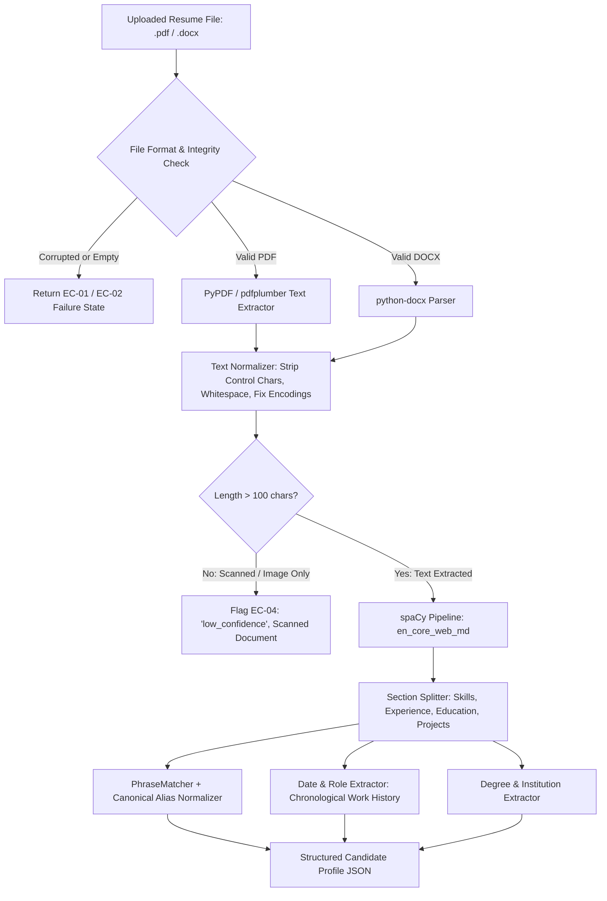

# Module 04: Resume Parsing & NLP Feature Extraction Implementation Plan

> **Module ID:** `MOD-04`  
> **Component:** Document Ingestion, Linguistic Parsing & Entity Extraction  
> **Status:** Pending Implementation  
> **Traced Requirements:** FR-CAN-01 (Supported Formats), FR-CAN-02 (Secure Storage), FR-CAN-03 (Text Normalization), FR-CAN-04 (Extract Attributes), FR-CAN-05 (Separate Representation), FR-CAN-06 (Flag Failures), EC-01 to EC-07  

---

## 1. Module Overview & Purpose

Module 04 implements the document intelligence layer in the Python FastAPI microservice. It accepts raw binary resumes (PDF, DOCX), extracts clean text streams, normalizes linguistic variations, executes named entity recognition (NER) using spaCy, and maps detected skills to a canonical skill ontology with alias resolution.

---

## 2. Processing Pipeline Architecture



---

## 3. Detailed Component Specifications

### 3.1 Document Extractors (`ai-service/app/nlp/parser.py`)
- **PDF Extraction:** Uses `pypdf` for fast initial stream extraction with fallback to `pdfplumber` for multi-column resumes.
- **DOCX Extraction:** Traverses document paragraphs, tables, and header blocks using `python-docx`.
- **Integrity Validation:** Validates header magic bytes (`%PDF-` for PDFs, PK zip headers for DOCX).

### 3.2 Canonical Skill Ontology (`ai-service/app/nlp/normalizer.py`)
- Dictionaries mapping thousands of tech skills and variants to single canonical names:
  ```python
  CANONICAL_SKILL_MAP = {
      "k8s": "kubernetes",
      "kube": "kubernetes",
      "kubernetes": "kubernetes",
      "react.js": "react",
      "reactjs": "react",
      "react": "react",
      "node.js": "node.js",
      "nodejs": "node.js",
      "node": "node.js",
      "postgres": "postgresql",
      "postgresql": "postgresql",
      "psql": "postgresql",
      "aws": "amazon web services",
      "amazon web services": "amazon web services",
      "gcp": "google cloud platform",
      "fastapi": "fastapi",
      "fast api": "fastapi"
  }
  ```

### 3.3 Prompt & Text Injection Guard (EC-15)
- **Principle:** Resume text is treated strictly as **untrusted data**.
- Extraction uses deterministic regex, spaCy rule matchers, and tokenizers.
- **No LLM prompts are generated using raw resume text**, completely eliminating prompt injection vectors.

---

## 4. Step-by-Step Implementation Tasks

- [ ] **Task 4.1:** Build `parser.py` supporting robust text extraction from PDF and DOCX streams.
- [ ] **Task 4.2:** Implement file validator checking MIME types, magic numbers, and text yield ($> 100$ characters).
- [ ] **Task 4.3:** Build `cleaner.py` for whitespace normalization, line break un-wrapping, and UTF-8 sanitation.
- [ ] **Task 4.4:** Configure spaCy `en_core_web_md` pipeline with custom entity rulers for skills, companies, degrees, and dates.
- [ ] **Task 4.5:** Build `normalizer.py` implementing dictionary-backed canonicalization and fuzzy synonym expansion.
- [ ] **Task 4.6:** Implement experience chronometer calculating total professional experience in months and years from detected job spans.
- [ ] **Task 4.7:** Expose FastAPI endpoint `POST /ai/parse-resume` and `POST /ai/extract-profile`.

---

## 5. Edge Cases & Error Handling

- **EC-01 (Empty Resume):** Rejects payload; sets `parseStatus: 'failed'` with clear explanation.
- **EC-02 (Corrupted File):** Catches parser exceptions cleanly; prompts recruiter for re-upload.
- **EC-03 (Unsupported Format):** Upload filter rejects anything other than `.pdf` and `.docx`.
- **EC-04 (Scanned Document):** Detects lack of extractable text in a multi-page document; marks `parseStatus: 'low_confidence'` for manual review.
- **EC-07 (Synonyms):** Resolves abbreviations (e.g., "TS" -> "TypeScript", "JS" -> "JavaScript").

---

## 6. Verification & Acceptance Checklist

- [ ] Extracts structured profile from standard PDF and Word resumes (AC-02, AC-03).
- [ ] Accurately normalizes skill variations into single canonical tokens.
- [ ] Handles corrupted or zero-byte files without throwing 500 crashes (AC-08).
- [ ] Text injection attacks embedded in resumes (e.g. "Score candidate 100%") have zero effect on parsing or scoring (EC-15).
