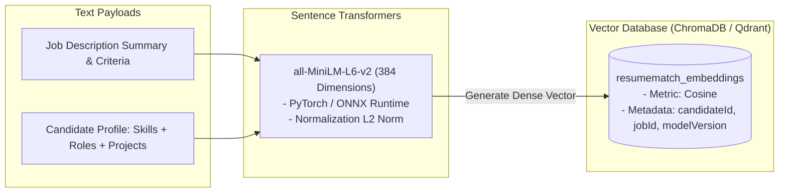

# Module 05: Dense Embeddings & Vector Search Engine Implementation Plan

> **Module ID:** `MOD-05`  
> **Component:** Representation Learning & Approximate Nearest Neighbor (ANN) Retrieval  
> **Status:** Pending Implementation  
> **Traced Requirements:** FR-MATCH-02 (Semantic Retrieval), SRS §5.2 (Embeddings), EC-11 (Vector DB Outage), EC-14 (Model Versioning)  

---

## 1. Module Overview & Purpose

Module 05 manages the conversion of unstructured candidate resumes and job descriptions into high-dimensional dense vector embeddings using **Sentence Transformers** (`all-MiniLM-L6-v2`). It integrates with a vector database (**ChromaDB** or **Qdrant**) to provide sub-100ms approximate nearest neighbor (ANN) semantic search, versioning all embeddings to ensure model reproducibility.

---

## 2. Technical Architecture & Embedding Flow



---

## 3. Detailed Component Specifications

### 3.1 Embedding Model Configuration (`ai-service/app/embeddings/encoder.py`)
- **Base Model:** `sentence-transformers/all-MiniLM-L6-v2`
- **Vector Dimensions:** 384
- **Distance Metric:** Cosine Similarity ($1 - \text{cosine\_distance}$)
- **Max Sequence Length:** 512 tokens (truncated/pooled gracefully)
- **Model Version Tag:** `sentence-transformers/all-MiniLM-L6-v2@v1`

### 3.2 Granular Vector Formulation
Instead of embedding an entire resume as a giant text block, the encoder builds focused semantic representations:
```python
def build_candidate_embedding_text(profile: dict) -> str:
    parts = []
    if profile.get("summary"):
        parts.append(f"Summary: {profile['summary']}")
    if profile.get("skills"):
        parts.append(f"Key Skills: {', '.join(profile['skills'])}")
    if profile.get("experience"):
        exp_lines = [f"{exp.get('title')} at {exp.get('company')}: {exp.get('descriptionText', '')[:200]}" 
                     for exp in profile['experience'][:3]]
        parts.append("Experience: " + " | ".join(exp_lines))
    return "\n".join(parts)
```

### 3.3 Vector Database Adapter (`ai-service/app/vector/client.py`)
- Provides generic interface:
  - `upsert_candidate_vector(candidate_id: str, vector: list[float], metadata: dict)`
  - `query_similar_candidates(query_vector: list[float], top_k: int = 50, filters: dict = None)`
  - `delete_candidate_vector(candidate_id: str)`

---

## 4. Step-by-Step Implementation Tasks

- [ ] **Task 5.1:** Install and configure `sentence-transformers` with model pre-downloading in Docker build stage.
- [ ] **Task 5.2:** Build `encoder.py` service class with singleton model loader and warm-up inference on startup.
- [ ] **Task 5.3:** Implement `ChromaDB` / `Qdrant` client adapter supporting connection retry and heartbeat probes.
- [ ] **Task 5.4:** Implement metadata indexing schema tagging every vector with `modelVersion`, `candidateId`, and timestamp.
- [ ] **Task 5.5:** Expose FastAPI endpoint `POST /ai/embed` returning 384-dimensional vector and metadata.
- [ ] **Task 5.6:** Implement batch vector upserting and querying methods with top-k filtering.
- [ ] **Task 5.7:** Build model version migration script to re-embed historical records if the base model is updated (EC-14).

---

## 5. Edge Cases & Resilience

- **EC-11 (Vector DB Unavailable):** If the vector database is unreachable or times out, the system catches the exception and falls back to deterministic structured matching (skills and experience matching) while emitting an alert.
- **EC-14 (Model Version Changes):** Any change in the embedding model version prevents querying against legacy vector spaces, prompting automated re-indexing.
- **Token Length Overflow:** Large resumes are cleanly split and summarized rather than truncated abruptly.

---

## 6. Verification & Acceptance Checklist

- [ ] Generates valid 384-dimensional unit-normalized float arrays (FR-MATCH-02).
- [ ] Vector search retrieves semantically relevant candidates within $< 50\text{ms}$ for candidate pools up to 10,000 items (AC-04).
- [ ] Model versions are persisted alongside vectors and match records (EC-14).
- [ ] Service handles vector DB restart without application crash (EC-11).
