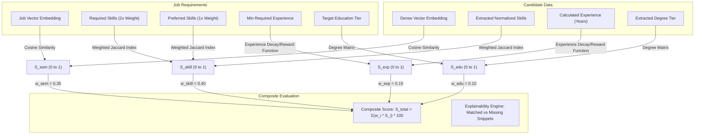

# Module 06: Hybrid Matching & Explainable Scoring Engine Implementation Plan

> **Module ID:** `MOD-06`  
> **Component:** Multi-Signal Ranking & Grounded Explainability  
> **Status:** Pending Implementation  
> **Traced Requirements:** FR-MATCH-01 to 07, FR-EVID-01 to 03, SRS §5.3 (Model), §5.4 (Explainability), AC-05, AC-06, AC-07  

---

## 1. Module Overview & Purpose

Module 06 is the intellectual core of ResumeMatch AI. It executes the hybrid ranking algorithm that combines dense semantic retrieval with structured rule-based signals (skills, experience, education). Crucially, it generates **grounded, human-readable evidence** explaining why each candidate matched or lacked specific criteria, while upholding the core product principle that **candidates are never automatically rejected by the AI**.

---

## 2. Mathematical Scoring Model



### 2.1 Formula Definitions
1. **Semantic Similarity ($S_{sem}$):**
   $$S_{sem} = \max\left(0, \frac{\mathbf{u}_{jd} \cdot \mathbf{v}_{cand}}{\|\mathbf{u}_{jd}\| \|\mathbf{v}_{cand}\|}\right)$$
2. **Skill Overlap ($S_{skill}$):**
   $$S_{skill} = \frac{2 \cdot |C \cap R| + 1 \cdot |C \cap P|}{2 \cdot |R| + 1 \cdot |P|}$$
   Where $R$ is Required Skills, $P$ is Preferred Skills, and $C$ is Candidate Skills.
3. **Experience Alignment ($S_{exp}$):**
   - If Candidate Exp $\ge$ Required Exp: $S_{exp} = 1.0$ (with slight bonus for seniority up to $+0.05$).
   - If Candidate Exp $<$ Required Exp: $S_{exp} = \max\left(0.2, \frac{\text{Candidate Exp}}{\text{Required Exp}}\right)$.
4. **Education Fit ($S_{edu}$):**
   - Matching or exceeding requested level yields $1.0$; lower degree level yields tiered partial credit ($0.7$ for Bachelor when Master requested).

---

## 3. Grounded Explainability & Evidence Formulation

The explainability engine outputs an inspection payload for the recruiter UI:
```json
{
  "overallScore": 86,
  "componentScores": {
    "semanticScore": 91,
    "skillScore": 85,
    "experienceScore": 80,
    "educationScore": 90
  },
  "evidence": {
    "matchedRequiredSkills": ["python", "fastapi", "docker"],
    "matchedPreferredSkills": ["kubernetes"],
    "missingRequiredSkills": ["postgresql"],
    "uncertainSkills": [],
    "supportingSnippets": [
      {
        "skillOrCriterion": "fastapi",
        "evidenceSnippet": "Architected high-throughput microservices using FastAPI and async Python...",
        "sourceSection": "experience"
      }
    ]
  },
  "advisoryDisclaimer": "Scores are intended for recruiter decision-support. Candidates are not automatically eliminated."
}
```

> [!IMPORTANT]
> **EC-08 & AC-06 Rule:** If an attribute is missing from the resume, it is labeled **"Not Mentioned in Document"** rather than **"Confirmed Absent"**.

---

## 4. Step-by-Step Implementation Tasks

- [ ] **Task 6.1:** Build `ai-service/app/ranking/scorer.py` implementing the mathematical scoring formulas.
- [ ] **Task 6.2:** Implement weighted Jaccard skill matcher with required vs preferred skill weights.
- [ ] **Task 6.3:** Implement experience chronometer evaluator and education tier matcher.
- [ ] **Task 6.4:** Build `ai-service/app/ranking/explainer.py` to extract evidence text spans supporting each match.
- [ ] **Task 6.5:** Expose FastAPI endpoint `POST /ai/calculate-match` accepting candidate batches and job criteria.
- [ ] **Task 6.6:** Implement configurable weights override allowing recruiters to customize $w_{sem}, w_{skill}, w_{exp}, w_{edu}$ per department.
- [ ] **Task 6.7:** Verify that candidates with low scores are still returned and never purged automatically (FR-MATCH-07, AC-07).

---

## 5. Edge Cases & Resilience

- **EC-12 (No Strong Candidates):** Returns all evaluated candidates sorted by score with transparent badges indicating lower confidence; does not artificially inflate scores.
- **EC-15 (Prompt Injection):** Calculation is purely mathematical and programmatic; no raw text is evaluated as LLM prompts.

---

## 6. Verification & Acceptance Checklist

- [ ] Composite scores fall strictly within $0 \le S \le 100$ (AC-05).
- [ ] Missing skills are accurately categorized as unmentioned rather than confirmed lack (AC-06).
- [ ] Low-scoring candidates are preserved in the result list (AC-07).
- [ ] Evidence snippets accurately quote original resume sections (FR-EVID-03).
