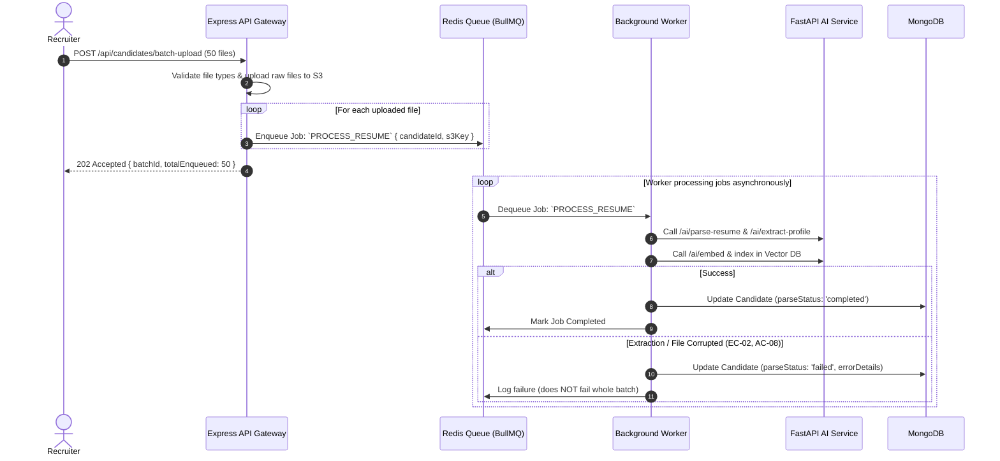

# Module 07: Asynchronous Queues & Background Workers Implementation Plan

> **Module ID:** `MOD-07`  
> **Component:** Asynchronous Task Processing & Queue Workers  
> **Status:** Pending Implementation  
> **Traced Requirements:** SRS §2.4 (Constraints: Non-blocking I/O), §3.1 (Redis Queue Support), AC-08 (Batch Fault Tolerance), EC-10 (Service Retry)  

---

## 1. Module Overview & Purpose

Module 07 decouples heavy, long-running operations (document parsing, entity extraction, embedding inference, and batch matching) from user-facing HTTP request/response loops. Using **Redis** with **BullMQ** (or Python Celery/RQ), it ensures that recruiters experience instant API response times ($< 100\text{ms}$) while resumes are processed reliably in the background with exponential retries and dead-letter queues.

---

## 2. Technical Architecture & Queue Flow



---

## 3. Queue Definitions & Job Contracts

### 3.1 Queues
- `resume-processing-queue`: Concurrency = 5 (worker pool for parsing, extraction, and embedding).
- `batch-matching-queue`: Concurrency = 2 (heavy matrix matching calculations across large pools).
- `audit-logging-queue`: Concurrency = 10 (asynchronous non-blocking persistence of audit events).

### 3.2 Job Payload Interface
```typescript
interface IResumeProcessJob {
  candidateId: string;
  s3Key: string;
  fileType: 'pdf' | 'docx';
  originalFileName: string;
  attemptCount: number;
}
```

---

## 4. Step-by-Step Implementation Tasks

- [ ] **Task 7.1:** Configure Redis connection in `backend/src/config/redis.ts` with connection retry and health monitoring.
- [ ] **Task 7.2:** Set up BullMQ Queue and Worker instances in `backend/src/queues/resumeQueue.ts`.
- [ ] **Task 7.3:** Implement exponential backoff retry policy (3 attempts, initial delay 2s, factor 2x).
- [ ] **Task 7.4:** Implement Dead Letter Queue (DLQ) for poisoned or unprocessable messages to prevent worker crashing.
- [ ] **Task 7.5:** Integrate batch fault isolation (AC-08): individual resume failure updates that candidate's status to `failed` without halting the remaining queue items.
- [ ] **Task 7.6:** Expose queue status & progress polling endpoint `GET /api/candidates/batch/:batchId/status`.
- [ ] **Task 7.7:** Implement BullMQ metrics collector for Prometheus (queue depth, active workers, failure rates).

---

## 5. Edge Cases & Resilience

- **EC-10 (AI Service Unavailable):** If the FastAPI microservice is restarting, worker retries jobs up to 3 times before moving them to a retry queue; user sees "Queued/Retrying" rather than a broken page.
- **AC-08 (Batch Processing Isolation):** An invalid or corrupt resume does not interrupt the other 49 resumes in a 50-file upload.

---

## 6. Verification & Acceptance Checklist

- [ ] HTTP upload responds with status 202 in $< 300\text{ms}$ regardless of file size.
- [ ] Background worker processes queue items continuously in order of priority.
- [ ] Failing a single resume in a 10-file upload leaves the other 9 in `completed` state (AC-08).
- [ ] Service crash during task execution recovers safely via Redis BullMQ lock renewal.
