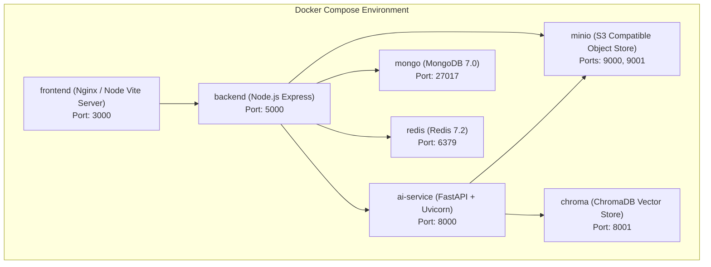

# Module 10: Infrastructure, Containerization & CI/CD Implementation Plan

> **Module ID:** `MOD-10`  
> **Component:** Docker Packaging, Multi-Container Orchestration & Cloud Deployment  
> **Status:** Pending Implementation  
> **Traced Requirements:** SRS §13 (Deployment and Infrastructure), §13.1 (Local Dev), §13.2 (Production), §13.3 (CI/CD), §9 (Portability)  

---

## 1. Module Overview & Purpose

Module 10 provides complete containerization, local orchestration, and deployment automation for ResumeMatch AI. It ensures that any engineer can spin up the entire multi-service ecosystem (Frontend, Gateway, AI Service, MongoDB, Redis, ChromaDB, and MinIO) locally with one command (`docker-compose up`) and deploys scalable manifests for Kubernetes on AWS EKS.

---

## 2. Containerization Architecture

---

## 3. Detailed Component Specifications

### 3.1 Dockerfile Specifications
1. **`infra/docker/Dockerfile.frontend`:** Multi-stage build (Node build -> Nginx alpine) for optimized production bundle ($< 25\text{MB}$).
2. **`infra/docker/Dockerfile.backend`:** Multi-stage TypeScript build (Node 20 alpine), runs unprivileged user `node`.
3. **`infra/docker/Dockerfile.ai-service`:** Python 3.11 slim base, installs spaCy and Sentence Transformers weights during image build, minimizing container boot time.

### 3.2 Kubernetes Manifests (`infra/k8s/`)
- `deployments/`: Separate deployments for `backend-deployment.yaml`, `ai-service-deployment.yaml`, and `frontend-deployment.yaml`.
- `hpa/`: Horizontal Pod Autoscaler for `ai-service` (target CPU $> 75\%$, min: 2, max: 10).
- `services/`: ClusterIP services and AWS ALB Ingress.
- `secrets/`: Externalized secret template (`resumematch-secrets.yaml`).

### 3.3 CI/CD GitHub Actions (`.github/workflows/ci.yml`)
- Stage 1: Linting & Type Checking (ESLint, Prettier, Flake8, Mypy).
- Stage 2: Automated Unit & Integration Tests.
- Stage 3: Docker Build & Vulnerability Scan (Trivy).
- Stage 4: Container Registry Push (AWS ECR / Docker Hub).

---

## 4. Step-by-Step Implementation Tasks

- [ ] **Task 10.1:** Author multi-stage `Dockerfile.frontend` with Nginx routing configuration for React SPA.
- [ ] **Task 10.2:** Author multi-stage `Dockerfile.backend` with production build scripts and non-root execution.
- [ ] **Task 10.3:** Author optimized `Dockerfile.ai-service` caching spaCy model `en_core_web_md` and Sentence Transformer weights.
- [ ] **Task 10.4:** Assemble master `docker-compose.yml` linking all 7 containers with health checks and volume persistence.
- [ ] **Task 10.5:** Author MinIO auto-initialization script to create bucket `resumematch-resumes` on boot.
- [ ] **Task 10.6:** Create Kubernetes manifests for AWS EKS deployment including HPA and readiness/liveness probes.
- [ ] **Task 10.7:** Configure GitHub Actions CI pipeline for continuous linting, testing, and container verification.

---

## 5. Security & Operations Safeguards

- **Non-Root Execution:** All containers run as unprivileged users (`UID 10001`).
- **Resource Constraints:** CPU and memory limits are explicitly declared on all services in Compose and Kubernetes to prevent runaway workloads.
- **Secret Isolation:** No secrets in Git; local `.env.example` provides self-documenting templates.

---

## 6. Verification & Acceptance Checklist

- [ ] `docker-compose up --build` brings up all services without dependency race conditions.
- [ ] Backend and AI microservices pass health checks and communicate across the Docker network.
- [ ] MinIO stores and serves resume blobs seamlessly replicating AWS S3 behavior.
- [ ] Kubernetes manifests pass `kubectl apply --dry-run=client` linting.
