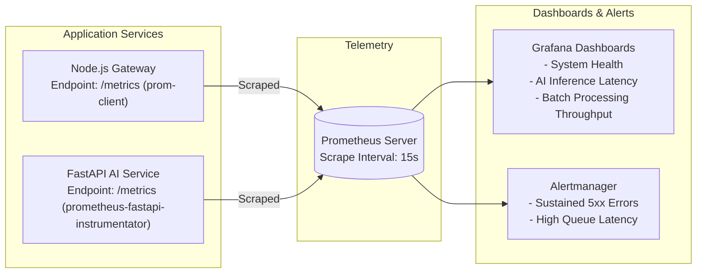

# Module 11: Observability, Monitoring & Auditing Implementation Plan

> **Module ID:** `MOD-11`  
> **Component:** Telemetry, Performance Metrics, Grafana Dashboards & Audit Trails  
> **Status:** Pending Implementation  
> **Traced Requirements:** SRS §12 (Observability and Monitoring), §12.1 (Metrics), §12.2 (Prometheus and Grafana), FR-AUTH-04, FR-EVID-06, AC-10  

---

## 1. Module Overview & Purpose

Module 11 establishes observability and regulatory compliance logging. It configures **Prometheus** metrics collection from both the Node.js API gateway and the Python FastAPI service, deploys **Grafana** operational dashboards, and maintains an append-only **Audit Log** tracking recruiter decisions, status updates, and candidate data exports.

---

## 2. Observability Architecture

---

## 3. Metrics & Audit Specifications

### 3.1 Prometheus Metrics Exposed
1. **API Gateway Metrics (`prom-client`):**
   - `http_requests_total{method, route, status}`: Throughput and HTTP error rates.
   - `http_request_duration_seconds`: API latency percentiles (p50, p95, p99).
   - `bullmq_jobs_waiting_total{queue}`: Redis queue depth.
2. **AI Service Metrics (`prometheus-fastapi-instrumentator`):**
   - `ai_resume_parse_duration_seconds`: Document extraction latency.
   - `ai_embedding_duration_seconds`: Sentence Transformer inference time.
   - `ai_matching_duration_seconds`: Hybrid ranking computation time.
   - `ai_failures_total{stage}`: Extraction or embedding failures count.

### 3.2 Audit Log Events (`FR-AUTH-04, FR-EVID-06`)
All events are recorded with `actorId`, `ipAddress`, `timestamp`, and `metadata`:
- `LOGIN_SUCCESS` / `LOGIN_FAILURE`
- `JOB_CREATED` / `JOB_UPDATED` / `JOB_STATUS_CHANGED`
- `RESUME_UPLOADED` / `RESUME_DOWNLOADED`
- `MATCH_EXECUTED`
- `CANDIDATE_STATUS_CHANGED` (e.g., transitioning to `shortlisted` or `rejected`)
- `RECRUITER_NOTE_ADDED`

---

## 4. Step-by-Step Implementation Tasks

- [ ] **Task 11.1:** Integrate `prom-client` into Node.js backend; expose `/metrics` endpoint guarded for administrative access.
- [ ] **Task 11.2:** Integrate `prometheus-fastapi-instrumentator` into Python FastAPI AI service; expose `/metrics`.
- [ ] **Task 11.3:** Configure `monitoring/prometheus/prometheus.yml` with scrape configurations for both services.
- [ ] **Task 11.4:** Create Grafana dashboard JSON configuration (`monitoring/grafana/dashboards/resumematch-overview.json`).
- [ ] **Task 11.5:** Implement `audit.service.ts` to asynchronously log all pipeline actions to MongoDB `audit_logs` collection.
- [ ] **Task 11.6:** Expose admin endpoint `GET /api/audit/logs` with pagination and date range filters (AC-10).
- [ ] **Task 11.7:** Configure health and readiness check endpoints (`/health`, `/ready`) across all services.

---

## 5. Security & Privacy Safeguards

- **Sensitive Data Redaction:** Audit logs record event metadata (IDs, changes, actor) but **never store raw resume texts or passwords**.
- **Admin-Only Access:** Observability endpoints and audit histories are restricted to users with `admin` role.

---

## 6. Verification & Acceptance Checklist

- [ ] Prometheus scrapes metrics successfully from `/metrics` endpoints (AC-10).
- [ ] Grafana dashboard visualizes latency, request volume, and AI worker throughput.
- [ ] Changing candidate status creates an immutable audit record in MongoDB (FR-EVID-06).
- [ ] Health checks respond with status 200 and accurate subsystem status.
